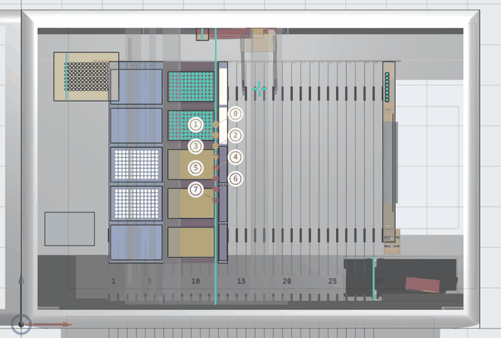
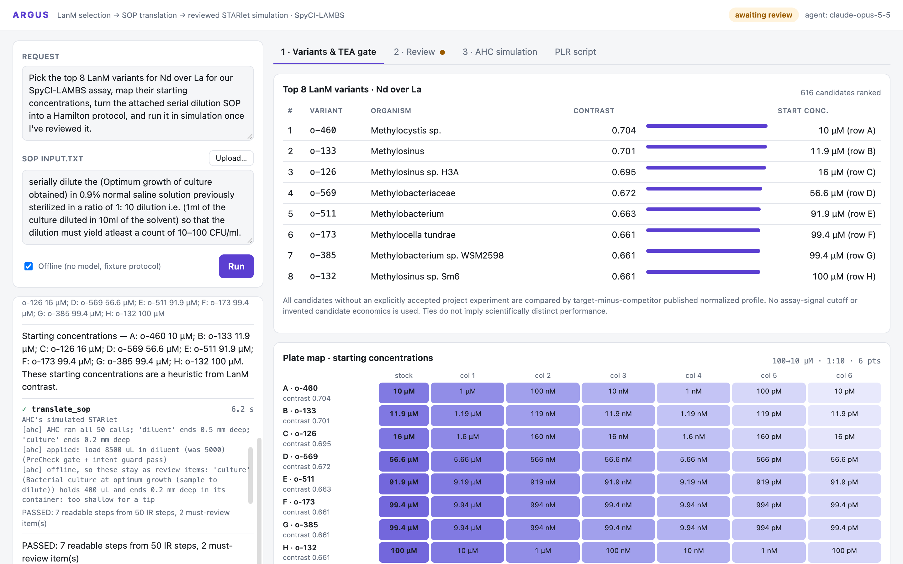
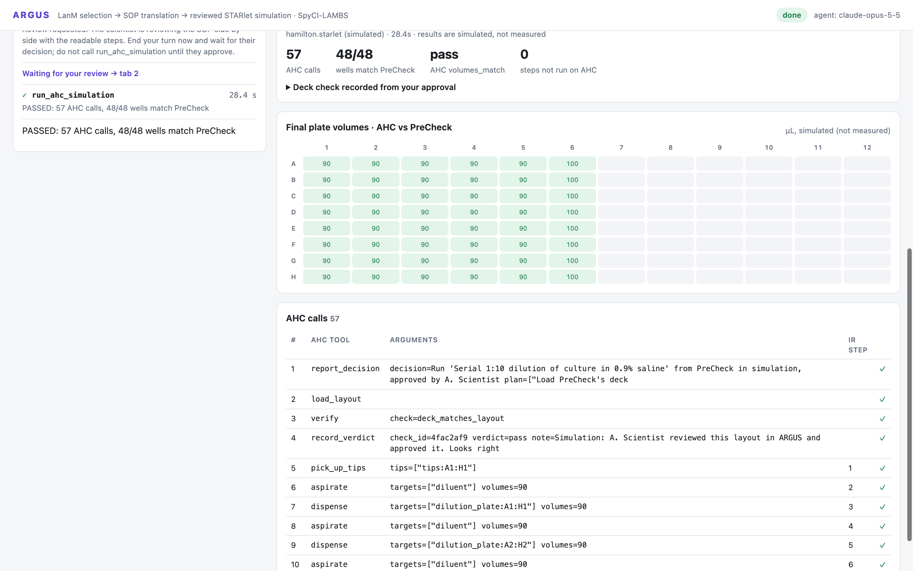
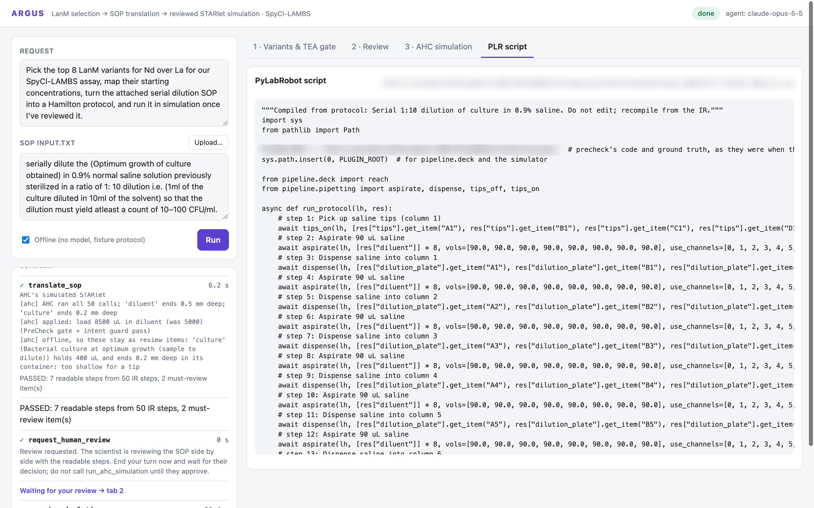

# ARGUS

ARGUS embeds **Oracle**, the complete research application, in a compact chat panel beneath the pipeline request form. Switch between **Chat** and **Build**, or **Expand** it for the full workspace. **Browse** opens candidates, database records, or tools in the expanded view. Oracle uses ARGUS's black-and-orange palette when embedded; the standalone application's appearance is unchanged. VENUS is not required for research.

## Oracle and shared records

`argus serve` starts the full research application on an automatically selected loopback port. ARGUS embeds it through its own `/research/` bridge; the original standalone application remains available through Oracle's separate-window arrow. Both services stop together. No model request is made during startup, and local model servers are not started automatically.

On first use, an empty `workspace/lanm` receives the verified shared starter: **616 candidates, 441 library records including 14 sources, and two registered method versions**. The starter does not migrate original projects, conversations, project sources, experiments or run history. The research application creates a fresh exploration project. The original standalone research database remains separate and untouched.

The research application and ARGUS ranking use that same directory. The dashboard's **Research project** selector and the embedded application's project selector stay in sync; **Refresh** reloads the list. **New project for this pipeline run** requests a separate project when ranking runs. Ranking saves its result without changing an existing project's metal pair, assumptions or candidate-specific records. A conflicting metal pair is refused. Project switches from pipeline results wait until an active research turn finishes. The protocol assistant retains its focused tools; the complete Chat and Build modes expose the platform's full tool set. Protocol calls appear in **Pipeline activity**, alongside the existing results tabs.

Existing ARGUS data is never replaced by a starter update. A directory containing files but no database is refused rather than overwritten. For a fresh separate installation set `ARGUS_WORKSPACE` to a new directory. Advanced existing-data reuse is available with `argus serve --lanm-data-dir PATH` or `ARGUS_LANM_DATA_DIR`; that path must already contain `research.sqlite3`. It is not required for transferring shared records and does not copy or merge history.

`--lanm-port PORT` (or `ARGUS_LANM_PORT`) optionally fixes the research service's port. `LANM_PROFILES_FILE` selects an existing model-profile configuration without importing projects or messages; otherwise profiles in the selected research directory are used. Model availability still depends on the configured local server or the user's provider sign-in. Weights and private credentials are not distributed by Git.

## Optional protocol workflow



*The approved serial dilution running on AHC's simulated STARlet, recorded from ARGUS and played back at 2×.*

For protocol automation, a scientist on the LLNL SpyCI-LAMBS team types a request and uploads an SOP. An agent calls each system as a tool:

| Step | System | Tool | What it does |
|---|---|---|---|
| 1 | LanM research platform (`automation-capstone-fall-2026`) | `rank_variants` | Ranks the top LanM variants by published screening contrast, target metal over competitor (default Nd over La). |
| 2 | Assay concentration mapping (ARGUS) | `map_starting_concentrations` | Gives one variant per plate row a starting concentration scaled by its contrast. |
| 3 | PreCheck | `translate_sop` | Turns the SOP plus the plate map into a Hamilton STARlet protocol. It self-heals the protocol against the instrument's simulator, keeps the intent guard in place, and produces readable steps. |
| 4 | Scientist | `request_human_review` | Shows the SOP and the robot's steps side by side, with PreCheck's flags and the deck layout. The scientist approves or asks for changes (`revise_protocol`). |
| 5 | AHC | `run_ahc_simulation` | Runs the approved version on AHC's simulated STARlet. It then checks every well's final volume against PreCheck's arithmetic. |

Nothing reaches the review until AHC has run it. After PreCheck heals a protocol, ARGUS does three things before the scientist sees it:

1. **AHC dry run.** ARGUS runs the whole protocol on AHC's simulator, using only the labware AHC accepts.
2. **Plate-map check.** ARGUS checks every well's concentration against the assay plate map, and checks that pre-filled wells are only sources the robot draws from.
3. **Fixes go back through PreCheck:**
   - A fix that leaves every well as planned (for example a larger diluent load) is applied when PreCheck's gate and intent guard pass it.
   - Anything else goes back to PreCheck as a revision, which is redrafted and healed under the intent guard.

A protocol AHC still refuses after three rounds is marked NOT READY and can't be sent for review. The Review tab shows every round under "Labware check with AHC".

`run_ahc_simulation` is refused in code until the scientist approves the exact version under review (checked by the IR hash). Any revision needs a new approval.

## Screenshots

These come from an earlier offline run of `PreCheck/files/input.txt`. The current first tab is named **Variants & assay map**.

**AHC simulation, live 3D deck.** PyLabRobot's 3D viewer draws the deck as each call moves tips and liquid. The head panels (96-head, the 8 channels, the gripper) are docked at the right edge so the whole machine stays in view.


**1 · Variants & assay map.** The top LanM variants for Nd over La, then the plate map of starting concentrations scaled by contrast.



**2 · Review.** The robot's steps in plain language. Each step quotes the SOP clause it carries out, and the full SOP stays in the left panel. Approve, or ask for changes.


**3 · AHC simulation, results.** The run's summary, final plate volumes from AHC compared with PreCheck's arithmetic, and every AHC call.



**PLR script.** PreCheck's standalone PyLabRobot script for the same protocol.



## Run it

You need Python 3.12 (uv installs it). Research uses the model backends configured for the research application. The optional protocol agent and PreCheck use the signed-in `claude` CLI; protocol translation also needs the VENUS labware library at the path saved by PreCheck setup. Without VENUS, research still starts normally and the protocol Run control explains the missing setup before making model requests.

**Native Windows:** research and the simulation imports work through ARGUS's scoped compatibility adapter. Physical AHC hardware access remains unsupported on native Windows: unavailable Unix file locks fail explicitly rather than becoming no-op locks. The optional protocol workflow still requires real VENUS labware definitions; their absence is not hidden by the compatibility adapter.

```bash
git submodule update --init --recursive
uv sync --locked
uv run argus serve            # http://127.0.0.1:8780
```

On Windows, after installing uv, double-click **Launch ARGUS.cmd**, or run `./launch-argus.ps1`. The launcher initializes missing submodules and installs the locked dependencies when the environment is absent. Use `./launch-argus.ps1 -Sync` after dependency updates. `-ProfilesFile PATH_TO_MODEL_PROFILES_JSON` selects an existing model configuration; it does not import research projects or conversations.

Click **Oracle** in the ARGUS header to jump to its compact panel, or use the separate-window arrow there. **Chat** and **Build** are available directly in the panel. **Expand** opens the complete workspace without reloading the conversation; **Collapse** returns to the compact conversation. **Browse** expands candidates, database records, or tools. Keep the launcher running while using either view.

The original protocol dashboard remains visible. Its request form starts with `PreCheck/files/input.txt` (a 1:10 serial dilution) and an example request. When protocol setup is available, select a research project if desired, then press **Run**. Without VENUS, the form explains the missing setup and disables protocol execution; Oracle remains available.

- **Variants & assay map:** the ranked variants, then the plate map of starting concentrations.
- **Review:** appears once PreCheck has a passing protocol. The SOP stays in the left panel, and each step quotes the SOP clause it carries out. Approve, or describe a change.
- **AHC simulation:**
  - A live 3D view of the simulated STARlet, using PyLabRobot's Viewer3D through AHC's `LiveView`. Tips leave the rack and wells fill as each call runs.
  - Every AHC call streams in as it runs.
  - Final plate volumes are shown against PreCheck's expected volumes.
  - The run pauses 0.5 s after each call (`ARGUS_SIM_PACE_S`) so it can be watched. `ARGUS_3D=0` turns the 3D view off.
  - The head panels are docked in a column at the right edge, smaller, instead of over the deck.
  - Each run is recorded. After it ends, **Replay run** plays it again in 3D at 0.5× to 4×, and you can orbit and zoom while it plays.
  - **Record GIF** replays the run at 2× through the viewer's own GIF recorder. ARGUS saves it with the run (`workspace/runs/<id>/ahc/run.gif`), offers it to download, and shows it below the view. Keep the tab open while it records, because a hidden tab stops drawing.
- **PLR script:** PreCheck's standalone PyLabRobot script.

**Offline mode** (the checkbox, or `uv run argus demo --offline` in a terminal):
- Runs the same tools in the same order with no model.
- Uses PreCheck's passing serial-dilution fixture instead of a fresh draft.
- Is useful for a demo without network access, and for the tests.

```bash
uv run pytest      # concentration formula, readable steps, IR->AHC translation, review gate, offline end-to-end
```

## Assay concentration mapping

LanM's ranking returns published screening contrasts, not required stock concentrations. ARGUS maps those contrasts to an assay plan with a heuristic:

```
start = c_max * (c_min / c_max) ** ((contrast - min) / (max - min))
```

- The variant with the highest screening contrast gets `c_min` and the lowest gets `c_max`. The defaults are 100 → 10 µM. Equal contrasts receive `c_max`.
- Concentrations are interpolated on a log scale between those two ends.
- Columns 1 to n hold the 1:10 series.
- The scientist can override any default in the request, for example "start between 50 and 5 µM, 8 points".
- Concentration bounds must be finite and positive, the dilution factor must exceed one, and the series must use 1–12 columns. Calculation values retain their precision; the interface formats them for display.
- Per-well concentrations shown in the review come from the protocol's own steps, using PreCheck's `trace_mixtures`, not from the nominal series.
- Once a protocol exists, changing the ranked variants or assay map requires a new run so the plan and protocol stay together.

This mapping is an assay-planning heuristic, not a techno-economic model. Published screening contrast does not establish a required protein dose, recovery, capacity, useful lifetime, or cost.

The research workspace contains a separate **separation-unit techno-economic model** in [`economics.py`](automation-capstone-fall-2026/platform/src/lanm_platform/economics.py). It connects declared output, cycle time, useful lifetime, and operating assumptions to material inventory, annual costs, and cost per kilogram of collected target. Its calculations are conditional scenarios, not a validated full-plant TEA. The full research workspace exposes this model and the registered custom cost methods; the narrower protocol assistant's concentration mapping does not invoke them. Shared records and registered methods are restored together only for a fresh workspace. See the [platform instructions](automation-capstone-fall-2026/platform/README.md).

## How it is wired

```
argus/
  config.py          paths; puts LanM and PreCheck on sys.path; PRECHECK_WORKDIR -> workspace/precheck
  lanm_workspace.py  verified shared-only bootstrap and lifecycle of the full research application
  tools/lanm.py      LanM Store.rank + assay concentration mapping + concentrations from a protocol
  tools/precheck.py  PreCheck's draft -> heal ladder -> finish chain, the fixture path, readable steps
  tools/ahc_sim.py   IR -> AHC calls; AHC's server in-process (sim, hamilton.starlet) via an MCP client
  viewer.py          PyLabRobot's 3D viewer served by ARGUS: live, recorded during a run, replayed over a websocket
  run.py             one run: tool implementations, review gate, event stream
  agent.py           Claude Agent SDK, in-process MCP server "argus"; no built-in tools; the offline driver
  server.py          FastAPI + server-sent events
  web/               the page (no build step); viewer_embed.js docks the heads and drives the viewer's GIF recorder
```

- **Read-only submodules:** ARGUS never writes into the submodules. Research defaults to `workspace/lanm` (an explicitly selected existing directory is also supported); other records go under `workspace/`, which is git-ignored:
  - `workspace/lanm`: LanM's SQLite database
  - `workspace/precheck`: drafts, decks, healed protocols, PreCheck run records
  - `workspace/runs/<id>`: `run.json` and the AHC task folder with AHC's run log
- **IR→AHC translation:**
  - `tips_on` becomes `pick_up_tips`, `tips_off` becomes `drop_tips`, and `aspirate`/`dispense` keep their names.
  - Plate targets become `plate:A<c>:H<c>`, and reservoirs become one shared target.
  - `incubate`/`shake`/`empty` are listed as skipped.
- **Deck check:** after `load_layout`, AHC's deck check of a new layout belongs to a person. ARGUS records the scientist's review approval as that verdict, since the review panel shows them the layout.
- **Volume checks:** final volumes are compared with PreCheck's expected volumes, and also with AHC's own `verify(volumes_match)`.

## Limits

- The offline fixture draws the sample for all 8 rows from one reservoir. PreCheck flags this as a must-review item. A live draft gets the plate map as assay context and is asked to give each row its own variant stock.
- Everything runs in simulation, and AHC volumes are the digital twin's, not measurements. Running on a real STARlet goes through AHC's own on-site flow, with a person present.
- Protocol runs are held in memory by the server. Each protocol run's `run.json` is kept in `workspace/runs/`. Research projects, conversations, evidence and analyses persist in the research database across restarts.
