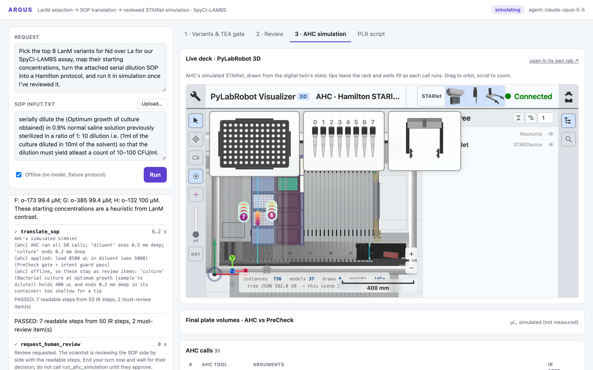
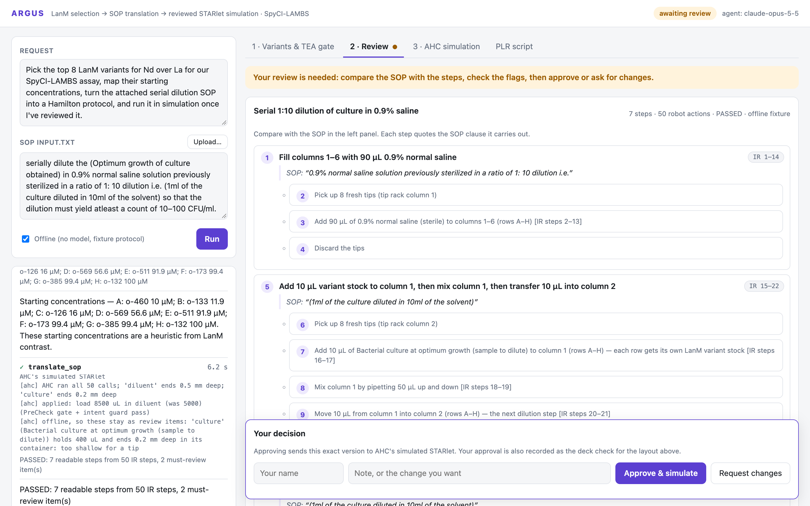

# ARGUS

ARGUS is one platform built from three systems. A scientist on the LLNL SpyCI-LAMBS team types one request and uploads an SOP. An agent then calls each system as a tool:

| Step | System | Tool | What it does |
|---|---|---|---|
| 1 | LanM research platform (`automation-capstone-fall-2026`) | `rank_variants` | Ranks the top LanM variants by published selectivity contrast, target metal over competitor (default Nd over La). |
| 2 | TEA gate (ARGUS) | `map_starting_concentrations` | Gives one variant per plate row a starting concentration scaled by its contrast. |
| 3 | PreCheck | `translate_sop` | Turns the SOP plus the plate map into a Hamilton STARlet protocol. It self-heals the protocol against the instrument's simulator, keeps the intent guard in place, and produces readable steps. |
| 4 | Scientist | `request_human_review` | Shows the SOP and the robot's steps side by side, with PreCheck's flags and the deck layout. The scientist approves or asks for changes (`revise_protocol`). |
| 5 | AHC | `run_ahc_simulation` | Runs the approved version on AHC's simulated STARlet. It then checks every well's final volume against PreCheck's arithmetic. |

Nothing reaches the review until AHC has run it. After PreCheck heals a protocol, ARGUS does three things before the scientist sees it:

1. **AHC dry run.** ARGUS runs the whole protocol on AHC's simulator, using only the labware AHC accepts.
2. **Plate-map check.** ARGUS checks every well's concentration against the TEA plate map, and checks that pre-filled wells are only sources the robot draws from.
3. **Fixes go back through PreCheck:**
   - A fix that leaves every well as planned (for example a larger diluent load) is applied when PreCheck's gate and intent guard pass it.
   - Anything else goes back to PreCheck as a revision, which is redrafted and healed under the intent guard.

A protocol AHC still refuses after three rounds is marked NOT READY and can't be sent for review. The Review tab shows every round under "Labware check with AHC".

`run_ahc_simulation` is refused in code until the scientist approves the exact version under review (checked by the IR hash). Any revision needs a new approval.

## Screenshots

These come from an offline run of `PreCheck/files/input.txt`.

**AHC simulation, live 3D deck.** The approved protocol runs on AHC's simulated STARlet, and PyLabRobot's 3D viewer draws the deck as each call moves tips and liquid.



**1 · Variants & TEA gate.** The top LanM variants for Nd over La, then the plate map of starting concentrations scaled by contrast.


**2 · Review.** The robot's steps in plain language. Each step quotes the SOP clause it carries out, and the full SOP stays in the left panel. Approve, or ask for changes.



**3 · AHC simulation, results.** The run's summary, final plate volumes from AHC compared with PreCheck's arithmetic, and every AHC call.


**PLR script.** PreCheck's standalone PyLabRobot script for the same protocol.


## Run it

You need Python 3.12 (uv installs it) and the `claude` CLI, logged in. The agent and PreCheck both use your Claude Code login, so no API key is needed. PreCheck also needs the VENUS labware library, at the path PreCheck's setup saved in `~/.config/precheck/config.json`.

```bash
git submodule update --init
uv sync
uv run argus serve            # http://127.0.0.1:8780
```

The page opens with `PreCheck/files/input.txt` (a 1:10 serial dilution) and an example request already filled in. Press **Run**.

- **Variants & TEA gate:** the ranked variants, then the plate map of starting concentrations.
- **Review:** appears once PreCheck has a passing protocol. The SOP stays in the left panel, and each step quotes the SOP clause it carries out. Approve, or describe a change.
- **AHC simulation:**
  - A live 3D view of the simulated STARlet, using PyLabRobot's Viewer3D through AHC's `LiveView`. Tips leave the rack and wells fill as each call runs.
  - Every AHC call streams in as it runs.
  - Final plate volumes are shown against PreCheck's expected volumes.
  - The run pauses 0.5 s after each call (`ARGUS_SIM_PACE_S`) so it can be watched. `ARGUS_3D=0` turns the 3D view off.
- **PLR script:** PreCheck's standalone PyLabRobot script.

**Offline mode** (the checkbox, or `uv run argus demo --offline` in a terminal):
- Runs the same tools in the same order with no model.
- Uses PreCheck's passing serial-dilution fixture instead of a fresh draft.
- Is useful for a demo without network access, and for the tests.

```bash
uv run pytest      # TEA formula, readable steps, IR->AHC translation, review gate, offline end-to-end
```

## The TEA gate (for now)

LanM ranks candidates but has no concentrations, so ARGUS maps them with a heuristic:

```
start = c_max * (c_min / c_max) ** ((contrast - min) / (max - min))
```

- The most selective variant gets `c_min` and the least selective gets `c_max`. The defaults are 100 → 10 µM.
- Concentrations are interpolated on a log scale between those two ends.
- Columns 1 to n hold the 1:10 series.
- The scientist can override any default in the request, for example "start between 50 and 5 µM, 8 points".
- Per-well concentrations shown in the review come from the protocol's own steps, using PreCheck's `trace_mixtures`, not from the nominal series.

## How it is wired

```
argus/
  config.py          paths; puts LanM and PreCheck on sys.path; PRECHECK_WORKDIR -> workspace/precheck
  tools/lanm.py      LanM Store.rank + the TEA gate + concentrations from a protocol
  tools/precheck.py  PreCheck's draft -> heal ladder -> finish chain, the fixture path, readable steps
  tools/ahc_sim.py   IR -> AHC calls; AHC's server in-process (sim, hamilton.starlet) via an MCP client
  run.py             one run: tool implementations, review gate, event stream
  agent.py           Claude Agent SDK, in-process MCP server "argus"; no built-in tools; the offline driver
  server.py          FastAPI + server-sent events
  web/               the page (no build step)
```

- **Read-only submodules:** ARGUS never writes into the submodules. Everything goes to `workspace/`, which is git-ignored:
  - `workspace/lanm`: LanM's SQLite database
  - `workspace/precheck`: drafts, decks, healed protocols, PreCheck run records
  - `workspace/runs/<id>`: `run.json` and the AHC task folder with AHC's run log
- **IR→AHC translation:**
  - `tips_on` becomes `pick_up_tips`, `tips_off` becomes `drop_tips`, and `aspirate`/`dispense` keep their names.
  - Plate targets become `plate:A<c>:H<c>`, and reservoirs become one shared target.
  - `incubate`/`shake`/`empty` are listed as skipped.
- **Deck check:** after `load_layout`, AHC's deck check of a new layout belongs to a person. ARGUS records the scientist's review approval as that verdict, since the review panel shows them the layout.
- **Volume checks:** final volumes are compared with PreCheck's expected volumes, and also with AHC's own `verify(volumes_match)`.

## Limits

- The offline fixture draws the sample for all 8 rows from one reservoir. PreCheck flags this as a must-review item. A live draft gets the plate map as assay context and is asked to give each row its own variant stock.
- Everything runs in simulation, and AHC volumes are the digital twin's, not measurements. Running on a real STARlet goes through AHC's own on-site flow, with a person present.
- Runs are held in memory by the server. Each run's `run.json` is kept in `workspace/runs/`.
